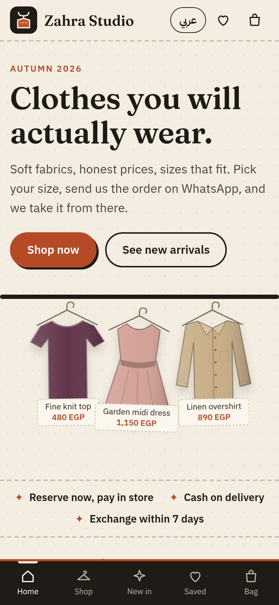
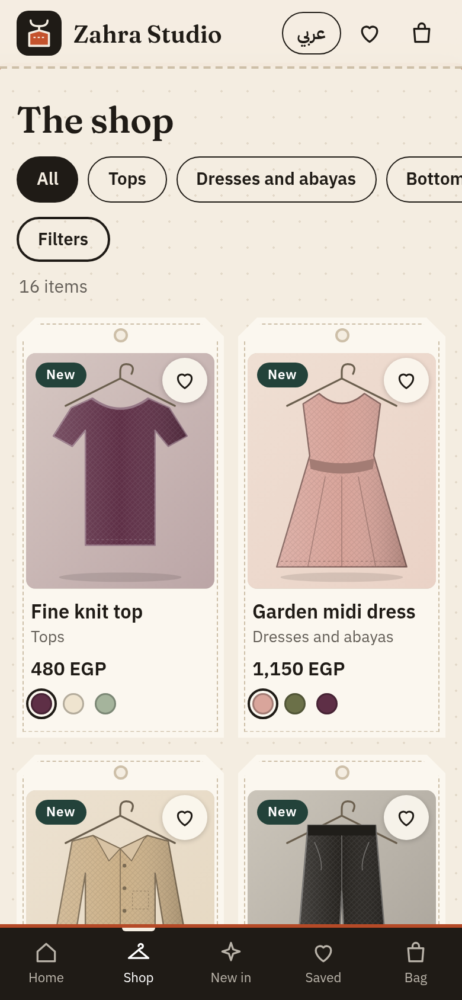
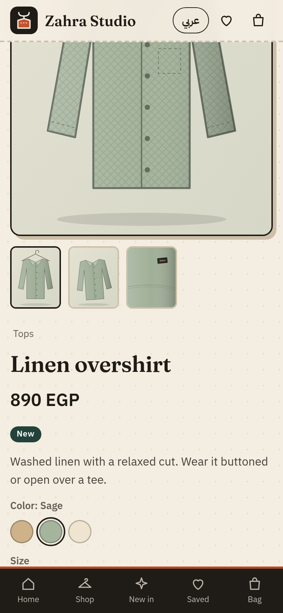
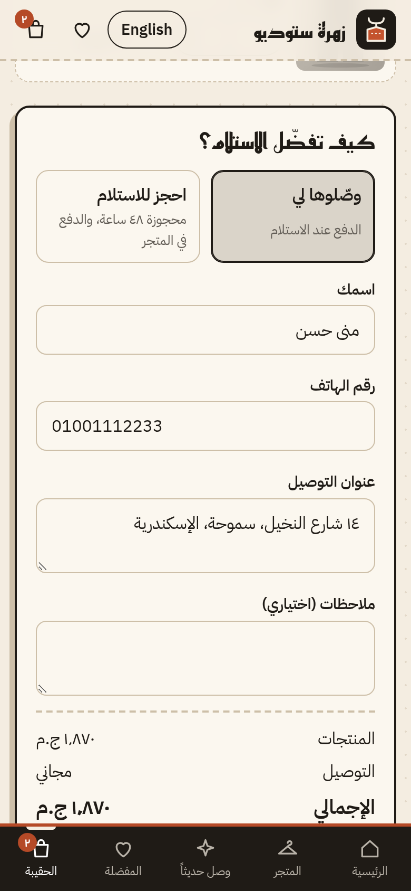
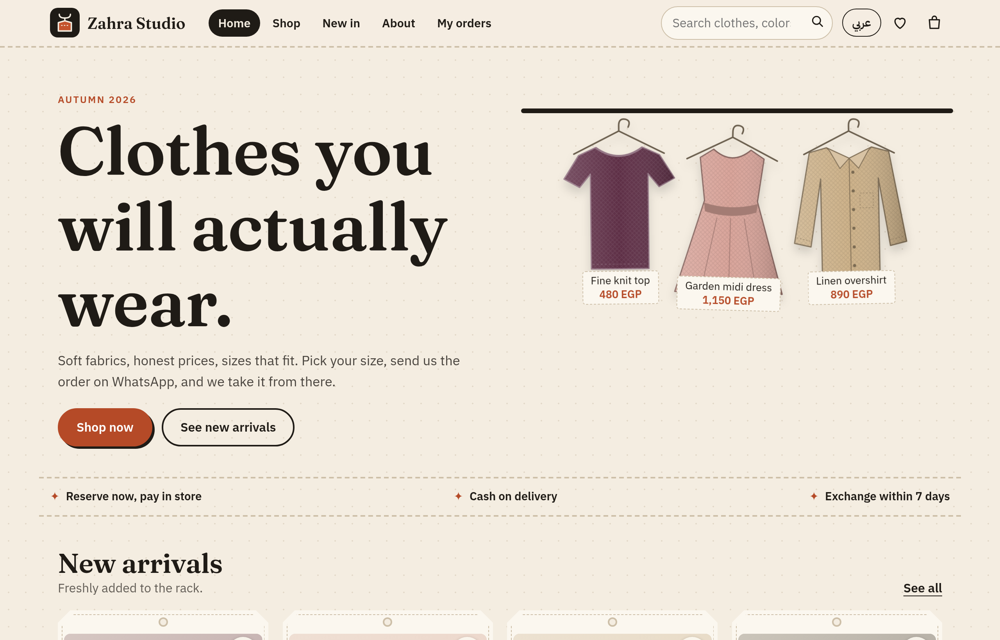

<p align="center"></p>

<h1 align="center">Lebs</h1>
<p align="center"><b>A white-label clothing store you rebrand by editing one file.</b><br>
Catalog with sizes and colors, orders and reservations that arrive on WhatsApp, a new-arrivals page, Arabic and English with full RTL.</p>

<p align="center"><a href="https://yousefkhames.github.io/lebs/"><b>Live demo</b></a> &middot;
<a href="https://yousefkhames.github.io/lebs/?demo=noor">Second brand (same code, other config)</a></p>

<p align="center">




</p>
<p align="center"></p>

## The pitch

Small clothing shops do their selling in WhatsApp and Instagram DMs. They do not need a payment gateway or a monthly platform fee. They need a clean catalog, customers who pick a size and color before they write, and a message that arrives already complete: items, sizes, total, name, phone, address.

Lebs is that, as a folder of static files. Put it on any free host, change `lebs.config.js`, and a new client has a branded store in an afternoon. "Hang tag" design: every product is a tag on a rail, with stitched borders and a punched hole, instead of the usual grid of white boxes.

## Features

- **Catalog**: categories, per-size stock, several colors per product, sale prices, "new" and "sold out" badges.
- **Photos**: give a product `images` (one list, or one list per color) and the store shows your photos. Without photos it draws the garment in every color, so a catalog works on day one.
- **Filter and search**: category, size (only sizes in stock), color, on sale, in stock, sort by newest or price, free-text search in Arabic or English (names, colors, categories).
- **New arrivals page**: automatic from each product's `added` date, grouped into this week, last week and earlier. The window (default 30 days) is in the config.
- **Bag**: stock-aware quantities (a size's stock is shared across colors), free-delivery threshold, survives reloads.
- **Order or reserve on WhatsApp**: "Deliver to me" (cash on delivery) or "Reserve for pickup" (held for N hours, pay in store). Opens WhatsApp with the full message written in the customer's language. Nothing is sent until the customer presses send.
- **Saved pieces** and **My orders** (history, "order again"), kept in the browser.
- **Share** a product with its color via the share sheet or WhatsApp.
- **Arabic and English**: one tap to switch, `dir` and `lang` follow, Arabic-Indic digits, logical CSS so layouts mirror correctly. Arabic and Latin phone input both work (`٠١٠٠...` is normalised).
- **Mobile first**: bottom tab bar on phones, top navigation on desktop. Keyboard and screen-reader friendly (labels, focus rings, reduced-motion respected).
- **One config**: name, logo, colors, contact, delivery rules, content and catalog. A built-in check shows a readable error if the config has a mistake.

## Tech

Plain HTML, CSS and JavaScript. No build step, no framework, no server, no tracking, no external requests (fonts are bundled). State is in `localStorage`. Tested with Node's built-in test runner and a real Chrome click-through (Puppeteer).

```
docs/                 the site (served by GitHub Pages)
  lebs.config.js      <- the one file you edit per client
  examples/           second demo brand (open with ?demo=noor)
  js/lib.js           pure logic: filters, cart, WhatsApp message, routing, config check
  js/app.js           UI
  js/art.js           garment drawings used when there are no photos
  js/i18n.js          interface strings, Arabic and English
tests/                unit tests + browser click-through
```

The browser click-through (67 checks: filters, bag, stock limits, WhatsApp links in both languages, reservation flow, RTL, accessibility, corrupted storage) was run against the live URL as well as locally. Screenshots in this README come from the live site, made by `tests/screenshots.mjs` with sample data.

Run it locally: `node tests/serve.js` then open http://localhost:8080/ (or open `docs/index.html` directly).
Run the tests: `npm install` then `npm test` (unit) and `npm run e2e` (needs Google Chrome; set `CHROME=/path/to/chrome` if it is not at `/usr/bin/google-chrome`). `BASE_URL=https://... npm run e2e` runs the same click-through against a deployed copy.

## Rebranding for a client

1. **Copy the repo** (fork it, or download the ZIP) for the client.
2. **Open `docs/lebs.config.js`** and change, top to bottom:
   - `brand`: name and tagline in both languages, `logo` (a square SVG or PNG in `docs/assets/`), `favicon`.
   - `theme`: five colors (`paper`, `card`, `ink`, `accent`, `accent2`, `line`). Text on buttons picks black or white by itself.
   - `whatsapp.number`: the client's number with country code, digits only. **The demo number is fake, replace it first.** `defaultCountryCode` is added when a customer types a number that starts with 0.
   - `currency`, `delivery` (fee, free-over amount, note), `reservationHoldHours`, `newArrivalsDays`.
   - `hero`, `about`, `contact`, `perks`: the words on the pages, in both languages.
   - `categories` and `palette` (color names and hex).
   - `products`: one entry each. Example:
     ```js
     { id: 'linen-overshirt', category: 'tops', price: 890, added: '2026-11-20',
       name: { en: 'Linen overshirt', ar: 'قميص كتان واسع' },
       desc: { en: 'Washed linen, relaxed cut.', ar: 'كتان مغسول بقصة مريحة.' },
       colors: ['sand', 'sage'],
       sizes: { S: 4, M: 6, L: 3, XL: 0 },          // pieces in stock, 0 = sold out
       images: { sand: ['photos/linen-sand-1.jpg', 'photos/linen-sand-2.jpg'],
                 sage: ['photos/linen-sage-1.jpg'] } // optional, or a plain list
     }
     ```
3. **Add photos** (optional): put files in `docs/photos/` and list them under `images`. Without `images`, set `art` to one of `tee shirt hoodie dress abaya trousers skirt jacket scarf`.
4. **Check it**: open the page. If something in the config is wrong the page lists exactly what. `npm test` also validates the demo configs.
5. **Publish**: any static host works (GitHub Pages from `/docs`, Netlify, Cloudflare Pages, a shared hosting folder). The second demo (`docs/examples/noor.config.js`, opened with `?demo=noor`) shows a full rebrand: other name, colors, currency, default language and catalog. For a client site you can delete `docs/examples/` and the `?demo=` lines in `docs/index.html`.

To update stock or add arrivals later, edit the config and upload it again. Dates use `added: 'YYYY-MM-DD'`. The demo config uses a `daysAgo()` helper only so its demo arrivals never go stale.

## Honest limits

- **It is a static demo store, not a full e-commerce platform.** There is no server, no database, no payment processing and no admin screen. The owner edits `lebs.config.js`.
- **Data is per browser.** The bag, saved pieces and order history live in that visitor's `localStorage`. They do not sync across devices, and clearing browser data removes them. The store owner does not see them: the owner's copy of an order is the WhatsApp message.
- **Stock is not live.** Stock numbers come from the config and are not reduced when someone orders. The owner confirms availability in the WhatsApp chat.
- **Orders depend on WhatsApp.** The customer must press send in WhatsApp. If WhatsApp is not installed the link opens WhatsApp Web.
- **The demo catalog uses drawn garments, not photographs**, and the store, products and WhatsApp number are made up. Real photos are supported through `images`.
- **GitHub Pages is a demo host.** Pages is fine for a demo, but for a paying client use a host with the terms and uptime they need (GitHub Pages is not meant for running a commercial business).
- Cross-browser testing so far is Chrome (desktop and a phone-size viewport). It uses standard features, but Safari and Firefox were not click-tested.
- Search is simple word matching, with no typo tolerance. Arabic search matches the exact words in the config (no diacritics or root handling).

## License

MIT. See [LICENSE](LICENSE). Bundled fonts are under the SIL Open Font License (see `docs/fonts/LICENSES.txt`).
